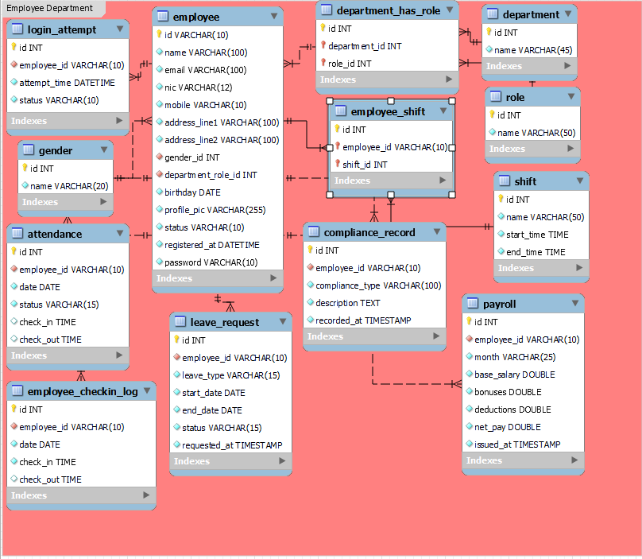

<h1 align="center">💼 LuxeFit HR Management</h1>

  
  
  
  

  <strong>LuxeFit</strong> is a desktop Human Resources management application built with Java Swing. It features employee administration, attendance tracking, and role-based dashboard routing.

> *Note: This is one of my early foundational projects, built to explore desktop application development, Java Swing UI design, and relational database management. It served as a stepping stone to my later enterprise web and mobile applications.*

---

## 📖 Overview

**LuxeFit** is a Java-based desktop application designed to manage HR workflows. The current implementation focuses on the HR department, providing a secure login, a dynamic dashboard, comprehensive employee CRUD (Create, Read, Update, Delete) operations, and daily attendance tracking with check-in/check-out logic.

## ✨ Key Features

### 🔐 Authentication & Routing
- Secure employee ID and password sign-in.
- Department-based routing (currently routes to the HR Dashboard).
- Strict password validation (length, case, special characters).
- Light/Dark mode theme toggle using FlatLaf.

### 👥 Employee Management
- Search, add, update, and delete employee records.
- Track personal details, NIC, contact info, address, department, and role.
- Automated duplicate NIC and mobile number validation.
- Profile picture assignment.

### ⏱️ Attendance Tracking
- HR dashboard for daily attendance monitoring.
- Employee check-in and check-out dialog.
- Automated calculation of `PRESENT` / `LATE` status based on shift times.
- Early checkout warnings.
- Filterable attendance logs by date, month, year, and department.

## 🛠️ Technology Stack

| Category | Technologies |
| :--- | :--- |
| **Language** | Java 11 |
| **UI Framework** | Java Swing, NetBeans GUI Builder |
| **Look & Feel** | FlatLaf 3.4.1 (Modern Dark/Light UI) |
| **Database** | MySQL 8.4, JDBC |
| **Reporting/Charts**| JasperReports 6.20, JFreeChart 1.5 |
| **Build Tool** | Apache Ant (NetBeans) |

## 🏗️ System Architecture

The project is a **desktop monolith** utilizing a panel-switching architecture:

1. **Entry Point:** `GUI.SignIn` initializes the application and authenticates the user.
2. **Controller:** `HRDashboard` acts as the main frame, dynamically swapping central panels (Home, Employee Management, Attendance) based on sidebar navigation.
3. **Data Access:** A centralized `Model.MySQL` class handles direct JDBC connections to the local MySQL database. 
4. **Data Flow:** Swing UI → Validation Classes → MySQL Helper → Database → `JTable` rendering.

## 🗄️ Database Schema

The application uses a highly relational MySQL database. Key tables include:
- **`employee`**: Core employee records, linked to `department`, `role`, and `shift`.
- **`attendance`**: Daily status (`PRESENT`/`LATE`), check-in and check-out times.
- **`employee_checkin_log`**: Raw log of all daily punch-in/punch-out events.
- **`login_attempt`**: Tracks login history.

**Entity-Relationship Diagram:**

  

## 🚀 Known Limitations & Future Enhancements

*(Note: As an early foundational project, the following production-level improvements were identified for future iterations).*
- [ ] **Security:** Implement Prepared Statements to prevent SQL injection (currently uses direct string interpolation).
- [ ] **Security:** Add password hashing (e.g., BCrypt) instead of plaintext storage.
- [ ] **Infrastructure:** Move hardcoded database credentials out of `MySQL.java` and into a configuration file.
- [ ] **Features:** Complete the placeholder modules (Leave Requests, Payroll, Shift Scheduler, Compliance).
- [ ] **Testing:** Implement JUnit tests for the data access layer.

## 👨‍💻 Author

**Himansu Nethsara Ranasinghe**
- 🎓 BSc (Hons) Software Engineering Undergraduate (JIAT / BCU)
- 🔗 [LinkedIn](https://www.linkedin.com/in/himansu-nethsara/)
- 🐙 [GitHub](https://github.com/HimansuNethsara)